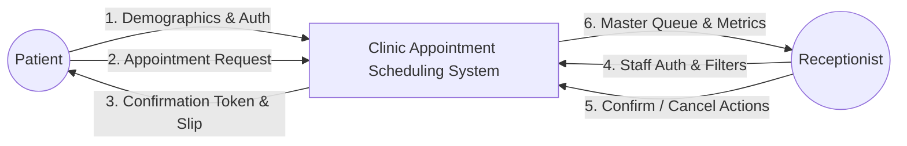
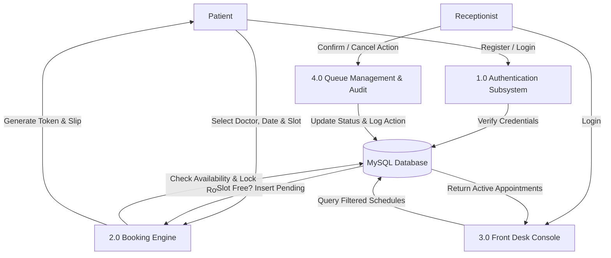
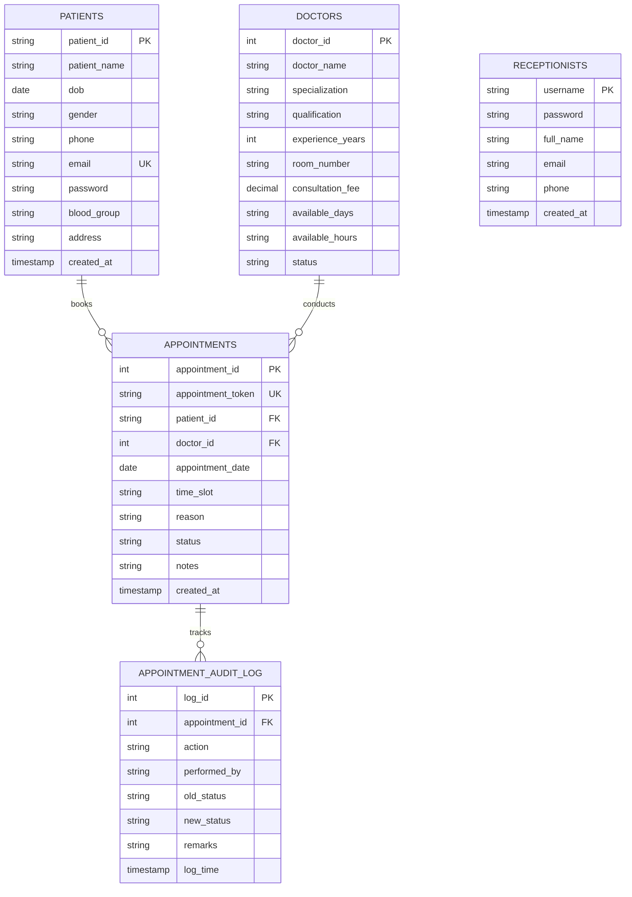

# CLINIC APPOINTMENT SCHEDULING SYSTEM
### A Skill Oriented Course Web Application / Project Report
Submitted in partial fulfillment of the requirements for the award of the Degree of  
**BACHELOR OF TECHNOLOGY** in **COMPUTER SCIENCE AND ENGINEERING**

By  
**Hemalatha Ganji** (Roll No: **24761A05S2**)  
*Class:* III B.Tech, V Semester, Section E  

Under the esteemed guidance of  
**Ms. K. Naga Rajeswari**, Assistant Professor, Department of CSE  

---

```
                   DEPARTMENT OF COMPUTER SCIENCE AND ENGINEERING
            LAKIREDDY BALI REDDY COLLEGE OF ENGINEERING (AUTONOMOUS)
            Accredited by NAAC with ‘A’ Grade & NBA (Under Tier - I), 
             An ISO 21001:2018, 14001:2015, 50001:2018 Certified Institution
              Approved by AICTE, New Delhi and Affiliated to JNTUK, Kakinada
              L.B. REDDY NAGAR, MYLAVARAM, NTR DIST., A.P. - 521230.
                                     2024–2028
```

---

### CERTIFICATE

This is to certify that the Skill Oriented Course Web Application / Project entitled **“Clinic Appointment Scheduling System”** is being submitted by:

$$\textbf{Hemalatha Ganji} \quad (\textbf{Regd. No: 24761A05S2})$$

in partial fulfillment of the requirements for the award of degree of **B.Tech in Computer Science and Engineering** from **Jawaharlal Nehru Technological University Kakinada (JNTUK)** is a record of Bonafide work carried out by her at **Lakireddy Bali Reddy College of Engineering (Autonomous)**.

The results embodied in this Skill Oriented Course Web Application / Project report have not been submitted to any other university or institute for the award of any degree or diploma.

<br>

| **Ms. K. Naga Rajeswari** <br> Assistant Professor (Project Guide) | **Dr. S. Nagarjuna Reddy** <br> Professor & Head of the Department (CSE) |
| :--- | :--- |

<br>

| **INTERNAL EXAMINER** | **EXTERNAL EXAMINER** |
| :---: | :---: |

---

### ACKNOWLEDGEMENT

I would like to express my heartfelt thanks to **Ms. K. Naga Rajeswari**, Assistant Professor, Department of CSE, for her insightful technical suggestions, continuous encouragement, and guidance throughout the development of this Skill Oriented Course Web Application / Project.

I also take this privilege to record my profound gratitude to **Dr. S. Nagarjuna Reddy**, Professor & Head of the Department of CSE, for providing the necessary laboratory environment, infrastructural facilities, and constant motivation that led to the successful completion of this project.

I convey my sincere gratitude to **Dr. K. Appa Rao**, Principal, **Lakireddy Bali Reddy College of Engineering (Autonomous)**, for fostering a technically stimulating atmosphere and providing all the institutional resources necessary for our academic growth.

I also thank the teaching and non-teaching faculty of the Department of Computer Science and Engineering for their direct and indirect cooperation.

Finally, I express my deepest gratitude to my parents and friends for their enduring blessings, moral support, and enthusiasm throughout my studies.

<br>
$$\textbf{Hemalatha Ganji} \quad (\textbf{24761A05S2})$$

---

### DECLARATION

I hereby declare that the project entitled **“Clinic Appointment Scheduling System”** is an authentic record of work carried out by me. I certify that the design, implementation, and documentation presented in this report are original and completed under the supervision of **Ms. K. Naga Rajeswari**, Assistant Professor, Department of Computer Science and Engineering.

This work has not been submitted previously to any other university or institute for the award of any degree or diploma. I have strictly complied with the guidelines established by Lakireddy Bali Reddy College of Engineering (Autonomous) and adhered to the academic ethics code of conduct.

Whenever concepts, algorithms, frameworks, or open-source libraries have been referenced, due credit has been extended in the bibliography and body of the text.

<br>
**Signature of the Student:**  
$$\textbf{Hemalatha Ganji} \quad (\textbf{24761A05S2})$$

---

### ABSTRACT

The **Clinic Appointment Scheduling System** is an enterprise-grade medical consultation booking and clinical queue management web application engineered to solve critical operational bottlenecks encountered in municipal healthcare centers, private outpatient departments (OPDs), and polyclinics. Traditional physical healthcare centers rely on manual paper registers, informal telephone bookings, and unstructured walk-in queues. These manual mechanisms suffer from catastrophic scheduling conflicts (such as double-booking doctors for the same consultation hour), inaccurate record-keeping, extensive patient waiting times, lack of digital auditability, and unauthorized access to medical records.

To eliminate these inefficiencies, this project introduces a secure, high-concurrency, database-driven web platform constructed strictly using **Java 21**, **Jakarta Servlets 6.0**, **Jakarta Server Pages (JSP 3.1)**, **JDBC**, and **MySQL 8.0**, deployed on **Apache Tomcat 10.1**. 

The system implements a distinct, dual-role architecture:
1. **Patient Subsystem:** Allows citizens and patients to register their demographic and medical profiles (`patient_id`, `name`, `dob`, `gender`, `phone`, `email`, `password`, `blood_group`, `address`). Patients authenticate using either their unique Patient ID or Email ID. The patient portal provides real-time doctor directory discovery across multiple clinical specializations (Cardiology, Pediatrics, General Medicine, Dermatology, Orthopedics, Gynecology). An intelligent appointment booking engine enables patients to select consultation dates and 30-minute time slots while describing symptoms. Crucially, the booking engine enforces **atomic concurrency protection** via database row-level locking (`SELECT ... FOR UPDATE`) and composite unique constraints (`UNIQUE KEY (doctor_id, appointment_date, time_slot)`), mathematically preventing two patients from booking the same doctor and slot simultaneously. Patients can track consultation statuses (`Pending` $\rightarrow$ `Confirmed` $\rightarrow$ `Completed` / `Cancelled`), cancel upcoming visits, and generate/print official **Digital Medical Appointment Slips** with unique alphanumeric tracking tokens (`APT-YYYY-XXXX`).
2. **Receptionist Subsystem:** Serves front-desk healthcare administrators with a high-visibility command center. The dashboard presents real-time key performance indicators (Total Bookings, Today's Consultations, Pending Verifications, Confirmed Schedules, Cancelled Appointments). Receptionists can filter and sort patient queues dynamically by consultation date, assigned doctor, and current status. With a single click, receptionists can verify and confirm pending schedules, cancel slots (releasing them back into the availability pool), or check in patients upon consultation completion, while maintaining a strict audit trail in `appointment_audit_log`.

Security and access control are guaranteed by two dedicated Jakarta servlet filters (`PatientAuthFilter` and `ReceptionistAuthFilter`), preventing unauthenticated URL snooping and enforcing complete role separation. The application strictly adheres to the **Model-View-Controller (MVC)** architectural pattern and **Data Access Object (DAO)** pattern, delivering a secure, responsive, and robust healthcare platform.

---

### LIST OF CONTENTS

| CONTENTS | PAGE NO |
| :--- | :--- |
| **ABSTRACT** | i |
| **LIST OF CONTENTS** | ii |
| **LIST OF ABBREVIATIONS** | iii |
| **LIST OF FIGURES** | iv |
| **LIST OF TABLES** | v |
| **1. INTRODUCTION** | 1–3 |
| &nbsp;&nbsp;&nbsp;&nbsp;1.1 Background of the Problem | 1 |
| &nbsp;&nbsp;&nbsp;&nbsp;1.2 Objectives of the System | 2 |
| &nbsp;&nbsp;&nbsp;&nbsp;1.3 Scope of the Application | 2 |
| &nbsp;&nbsp;&nbsp;&nbsp;1.4 Feasibility Study (Technical, Operational, Economic) | 3 |
| **2. TECHNOLOGIES USED** | 4–6 |
| &nbsp;&nbsp;&nbsp;&nbsp;2.1 Frontend: HTML5, CSS3, JavaScript & Bootstrap 5.3 | 4 |
| &nbsp;&nbsp;&nbsp;&nbsp;2.2 Backend: Java 21, Jakarta Servlets 6.0 & Tomcat 10.1 | 5 |
| &nbsp;&nbsp;&nbsp;&nbsp;2.3 Persistence: MySQL 8.0, JDBC & ACID Transactions | 5 |
| &nbsp;&nbsp;&nbsp;&nbsp;2.4 Presentation & Security: JSP 3.1, JSTL 3.0 & BCrypt | 6 |
| **3. WEB APPLICATION ARCHITECTURE** | 7–11 |
| &nbsp;&nbsp;&nbsp;&nbsp;3.1 Three-Tier MVC Architecture Model | 7 |
| &nbsp;&nbsp;&nbsp;&nbsp;3.2 High-Level System Architecture Diagram | 8 |
| &nbsp;&nbsp;&nbsp;&nbsp;3.3 Data Flow Diagrams (DFD Level 0, Level 1, Level 2) | 9 |
| &nbsp;&nbsp;&nbsp;&nbsp;3.4 UML Use Case, Sequence, and Class Diagrams | 10 |
| &nbsp;&nbsp;&nbsp;&nbsp;3.5 Relational Database Schema & ER Diagram | 11 |
| **4. CODING & IMPLEMENTATION** | 12–25 |
| &nbsp;&nbsp;&nbsp;&nbsp;4.1 Build Configuration (`pom.xml`) & Properties | 12 |
| &nbsp;&nbsp;&nbsp;&nbsp;4.2 Database Initialization Script (`clinic_appointment_db.sql`) | 13 |
| &nbsp;&nbsp;&nbsp;&nbsp;4.3 Database Connection Utility (`DBConnectionUtil.java`) | 15 |
| &nbsp;&nbsp;&nbsp;&nbsp;4.4 Domain Models (`Patient`, `Doctor`, `Appointment`, `Receptionist`) | 16 |
| &nbsp;&nbsp;&nbsp;&nbsp;4.5 Data Access Objects & Concurrency (`AppointmentDAO.java`) | 18 |
| &nbsp;&nbsp;&nbsp;&nbsp;4.6 Access Control Filters (`PatientAuthFilter`, `ReceptionistAuthFilter`) | 20 |
| &nbsp;&nbsp;&nbsp;&nbsp;4.7 Controller Servlets (`BookAppointmentServlet`, `ReceptionistServlet`) | 21 |
| &nbsp;&nbsp;&nbsp;&nbsp;4.8 Presentation Layer (`patient_home.jsp`, `receptionist_dashboard.jsp`, `slip.jsp`) | 23 |
| **5. RESULTS & SYSTEM DEMONSTRATION** | 26–31 |
| &nbsp;&nbsp;&nbsp;&nbsp;5.1 Operational Screen Walkthroughs (Screens 1 to 8) | 26 |
| &nbsp;&nbsp;&nbsp;&nbsp;5.2 Concurrency Conflict Resolution Demonstration | 28 |
| &nbsp;&nbsp;&nbsp;&nbsp;5.3 Software Test Cases & Verification Matrix | 29 |
| **6. CONCLUSION & FUTURE SCOPE** | 32 |
| **7. REFERENCES** | 33 |
| **8. PO, PSO & SUSTAINABLE DEVELOPMENT GOALS (SDG) ALIGNMENT** | 34–38 |
| &nbsp;&nbsp;&nbsp;&nbsp;8.1 Problem Statement & Main Objectives | 34 |
| &nbsp;&nbsp;&nbsp;&nbsp;8.2 Intended Beneficiaries & Impact Evidence | 35 |
| &nbsp;&nbsp;&nbsp;&nbsp;8.3 Program Outcomes (PO1–PO12) Mapping | 36 |
| &nbsp;&nbsp;&nbsp;&nbsp;8.4 Program Specific Outcomes (PSO1–PSO2) Mapping | 37 |
| &nbsp;&nbsp;&nbsp;&nbsp;8.5 UN Sustainable Development Goals (SDG 3, 8, 9, 12) Mapping | 38 |

---

### LIST OF ABBREVIATIONS

| ABBREVIATION | FULL FORM / DESCRIPTION |
| :--- | :--- |
| **OPD** | Outpatient Department — Hospital section for patients receiving medical advice without overnight stay |
| **MVC** | Model-View-Controller — Architectural software pattern decoupling data, logic, and presentation |
| **DAO** | Data Access Object — Design pattern encapsulating database queries and transactions |
| **JDBC** | Java Database Connectivity — Standard Java library for interacting with SQL databases |
| **JSP** | Jakarta Server Pages — Server-side templating engine for dynamically rendering web pages |
| **JSTL** | Jakarta Standard Tag Library — Standard tags for loops, conditionals, and formatting in JSP |
| **API** | Application Programming Interface — Defined interface allowing software components to interact |
| **SQL** | Structured Query Language — Declarative domain-specific language for relational database management |
| **ACID** | Atomicity, Consistency, Isolation, Durability — Four fundamental properties of dependable database transactions |
| **HTTP** | HyperText Transfer Protocol — Underlying communication protocol of the World Wide Web |
| **HTML5** | HyperText Markup Language Revision 5 — Standard markup language for building web structures |
| **CSS3** | Cascading Style Sheets Level 3 — Style sheet language used for presenting responsive web layouts |
| **DFD** | Data Flow Diagram — Graphical representation of the flow of data through an information system |
| **ERD** | Entity-Relationship Diagram — Visual model depicting database entities and their relationships |
| **UML** | Unified Modeling Language — Standardized modeling language for software engineering design |
| **SDG** | Sustainable Development Goals — 17 interlinked global objectives established by the United Nations |

---

### 1. INTRODUCTION

#### 1.1 Background of the Problem
Healthcare delivery in developing urban centers and suburban towns (such as Mylavaram and Vijayawada) has expanded exponentially over the last decade. Polyclinics and multi-speciality outpatient health facilities handle hundreds of patients daily. However, a significant majority of clinics continue to manage appointments through physical register books, telephone calls, or disorderly walk-in lines.

This traditional approach introduces severe operational bottlenecks:
1. **Double-Booking Conflicts:** Manual entry frequently results in two or more patients being assigned the same doctor during the exact same time slot, leading to physician exhaustion, delayed consultations, and severe patient frustration.
2. **Prolonged Waiting Times:** Unscheduled walk-in crowds cause unpredictable congestion in waiting rooms, exposing vulnerable patients (especially children, pregnant women, and elderly citizens) to nosocomial infections.
3. **Absence of Real-Time Visibility:** Patients have no means to know whether a doctor is available, on leave, or delayed before physically arriving at the hospital.
4. **Data Errors and Missing Records:** Hand-written records lead to misplaced demographic details, phone numbers, and previous consultation notes.
5. **Lack of Auditability:** Traditional desks have no automated logging mechanism to track which staff member confirmed, rescheduled, or cancelled a patient's appointment.

#### 1.2 Objectives of the System
The primary objective of the **Clinic Appointment Scheduling System** is to design, develop, and deploy an automated, secure, and intuitive web application that modernizes the outpatient consultation lifecycle:
* Provide patients with a seamless, 24/7 self-service portal to browse specialists, check consultation cabin details and fees, and reserve consultation slots.
* Implement **deterministic concurrency control** at both the application and database tiers to eliminate double-booking for any doctor and time slot.
* Enable receptionists and front-desk personnel to monitor the master clinic schedule, filter appointments by date and medical specialist, and update appointment statuses (`Pending` $\rightarrow$ `Confirmed` $\rightarrow$ `Completed` / `Cancelled`) with automated audit tracking.
* Automatically generate an official, printable **Digital Medical Appointment Slip / Token** featuring doctor cabin numbers, patient demographics, and instructions to expedite OPD check-in.
* Enforce robust security, role-based access control, parameterized database access, and session integrity.

#### 1.3 Scope of the Application
The scope encompasses all primary outpatient scheduling activities across multi-speciality departments (Cardiology, Pediatrics, General Medicine, Dermatology, Orthopedics, and Gynecology):
* **In Scope:** Patient registration and profile management, dual-credential authentication (Patient ID / Email), doctor directory discovery, real-time slot conflict detection, front-desk dashboard with date/doctor/status filters, status transition persistence in MySQL, audit logging, printable appointment tokens, and session-based access control filters.
* **Out of Scope (Future Phases):** Inpatient (IPD) bed allocation, integration with commercial SMS gateways, electronic health record (EHR) diagnostic imaging storage, and third-party commercial payment gateways (the system is optimized for direct on-desk clinic fee payment).

#### 1.4 Feasibility Study
Before initiating system development, an in-depth feasibility assessment was conducted across three essential axes:

1. **Technical Feasibility:** The system is architected using enterprise-grade, mature, and open-source Java technologies: **Java 21 LTS**, **Jakarta Servlets 6.0**, **JSP 3.1**, and **MySQL 8.0**, running on **Apache Tomcat 10.1**. These platforms are renowned for rock-solid stability, cross-platform portability, high concurrent throughput, and robust multi-threading capabilities. Concurrency protection is achieved using native MySQL InnoDB row-level locking (`SELECT ... FOR UPDATE`) and composite unique constraints, requiring no external complex messaging middleware.
2. **Operational Feasibility:** The user interface is built using modern **Bootstrap 5.3** and custom CSS adhering to a clinical healthcare palette (Trust Blue `#0284c7`, Teal `#0d9488`, Clean White `#ffffff`, and Slate `#0f172a`). Patients of varying digital literacy can easily select a doctor, choose a date and time slot with intuitive pill buttons, and receive an instant token within four clicks. Receptionists are provided with a dedicated command console with real-time KPI metric cards and one-click confirm/cancel action triggers.
3. **Economic Feasibility:** The entire technological stack utilized—including Java OpenJDK, Apache Tomcat, MySQL Community Edition, Apache Maven, and Bootstrap—is free and open-source, eliminating costly commercial software licensing. The application runs smoothly on standard low-cost commodity hardware or local on-premises clinic servers, making it economically accessible to rural and semi-urban medical centers.

---

### 2. TECHNOLOGIES USED

#### 2.1 Frontend: HTML5, CSS3, JavaScript & Bootstrap 5.3
The presentation layer delivers a fast, responsive, and aesthetically pleasing interface across mobile devices, tablets, and desktop workstations:
* **HTML5:** Semantic document structuring (`<header>`, `<nav>`, `<main>`, `<section>`, `<footer>`, `<dialog>`, `<form>`) ensures cross-browser accessibility and structured data presentation.
* **CSS3 (`clinic-style.css`):** Custom healthcare stylesheet establishing visual hierarchy. Features CSS variables for the color palette, card hover elevation, pill status badges (`badge-status-confirmed`, `badge-status-pending`, `badge-status-cancelled`), and print-specific stylesheets (`@media print`) that format medical appointment slips cleanly on standard A4 paper while suppressing navigation bars and buttons.
* **JavaScript (ES6+):** Provides client-side dynamic interactivity: dynamic calendar restrictions (enforcing `min = today` to disallow historical dates), interactive time slot button toggles, asynchronous parameter passing, and confirmation modal dialogs for appointment cancellations.
* **Bootstrap 5.3.3 & Bootstrap Icons 1.11.3:** Delivers responsive grid layouts, fluid tables, metric cards, navigation bars, and medical iconography without dependency on bulky third-party libraries.

#### 2.2 Backend: Java 21, Jakarta Servlets 6.0 & Apache Tomcat 10.1
* **Java 21 LTS:** Serves as the core programming platform, offering enhanced language capabilities, strong type safety, superior memory management, and modern garbage collection performance.
* **Jakarta Servlets 6.0:** Implements the Controller tier under the MVC paradigm. Servlets extend `HttpServlet`, intercepting incoming HTTP `GET` and `POST` requests, parsing request parameters, coordinating with the Data Access Object (DAO) layer, binding session attributes, and redirecting or dispatching to JSP views.
* **Apache Tomcat 10.1:** An enterprise-ready, open-source HTTP servlet container compliant with the Jakarta EE 10 specification. It efficiently manages worker thread pools, handles concurrent client connections, and maintains `HttpSession` lifecycles.

#### 2.3 Persistence: MySQL 8.0, JDBC & ACID Transactions
* **MySQL 8.0 Database Engine:** Relational storage powered by the InnoDB engine, providing full ACID (Atomicity, Consistency, Isolation, Durability) guarantees, relational foreign keys with cascading options, and specialized unique index structures.
* **Java Database Connectivity (JDBC):** Provides low-overhead direct database communication via `com.mysql.cj.jdbc.Driver`.
* **Parameterized `PreparedStatement`:** All SQL operations strictly use parameterized queries where user inputs are bound via typed setter methods (`setString()`, `setInt()`, `setDate()`), eliminating all vectors of SQL Injection attacks.
* **Pessimistic Concurrency & Transactions:** The critical booking transaction turns off autocommit (`conn.setAutoCommit(false)`), executes a locked verification query (`SELECT ... FOR UPDATE`), performs the insertion, records the audit trail, and commits the transaction atomically.

#### 2.4 Presentation & Security: JSP 3.1, JSTL 3.0 & BCrypt
* **Jakarta Server Pages (JSP 3.1) & JSTL 3.0:** Delivers dynamic server-side rendering while preserving strict separation of concerns. JSTL core tags (`<c:forEach>`, `<c:if>`, `<c:choose>`, `<c:set>`) iterate over domain model lists and render conditional status indicators without embedding raw Java scriptlets.
* **BCrypt Password Security (`jBCrypt 0.4`):** Implements adaptive one-way cryptographic hashing for passwords, combining random salt generation with key-stretching work factors.
* **Role-Based Authentication Filters:** `PatientAuthFilter` and `ReceptionistAuthFilter` guard protected application paths, verifying session attributes and invalidating cookies on logout (`session.invalidate()`).

---

### 3. WEB APPLICATION ARCHITECTURE

#### 3.1 Three-Tier MVC Architecture Model

```
+-----------------------------------------------------------------------------------+
|                            PRESENTATION TIER (VIEW)                               |
|  - Patient Views: index.jsp, patient_login.jsp, patient_register.jsp              |
|  - Booking & Portal: patient_home.jsp, my_appointments.jsp, appointment_slip.jsp  |
|  - Receptionist Views: receptionist_login.jsp, receptionist_dashboard.jsp         |
|  - Styling: Bootstrap 5.3, Custom clinic-style.css, Print @media CSS              |
+-----------------------------------------+-----------------------------------------+
                                          |  HTTP Requests (GET / POST)
                                          v
+-----------------------------------------------------------------------------------+
|                        APPLICATION CONTROLLER & FILTER TIER                       |
|  - Access Security Filters: PatientAuthFilter, ReceptionistAuthFilter             |
|  - Controller Servlets: PatientLoginServlet, PatientRegisterServlet,              |
|    PatientHomeServlet, BookAppointmentServlet, MyAppointmentsServlet,             |
|    AppointmentSlipServlet, ReceptionistLoginServlet,                              |
|    ReceptionistDashboardServlet, AppointmentActionServlet, LogoutServlet          |
+-----------------------------------------+-----------------------------------------+
                                          |  Service Invocations
                                          v
+-----------------------------------------------------------------------------------+
|                          BUSINESS LOGIC & DATA ACCESS (DAO)                       |
|  - PatientDAO: registerPatient(), authenticate(), isPatientIdExists()             |
|  - DoctorDAO: getAllDoctors(), getDoctorById(), getAllSpecializations()           |
|  - ReceptionistDAO: authenticate(), getReceptionist()                             |
|  - AppointmentDAO: bookAppointment() [Transactional with Row Locking],           |
|    isSlotBooked(), getAppointmentsByPatient(), getAppointmentsByFilter(),         |
|    updateStatus(), getAppointmentById(), getDashboardMetrics()                    |
|  - Utilities: DBConnectionUtil, PasswordUtil (BCrypt)                             |
+-----------------------------------------+-----------------------------------------+
                                          |  JDBC Parameterized SQL Statements
                                          v
+-----------------------------------------------------------------------------------+
|                         DATABASE STORAGE TIER (MySQL 8.0)                         |
|  - Table patients: patient_id (PK), patient_name, dob, gender, phone, email, etc. |
|  - Table doctors: doctor_id (PK), doctor_name, specialization, room, fee, etc.    |
|  - Table receptionists: username (PK), password, full_name, email, phone          |
|  - Table appointments: appointment_id (PK), token (UQ), patient_id (FK),          |
|    doctor_id (FK), date, slot, reason, status [CONSTRAINT uq_doctor_slot]         |
|  - Table appointment_audit_log: log_id (PK), appointment_id, action, status       |
+-----------------------------------------------------------------------------------+
```

#### 3.2 High-Level System Architecture
The application architecture is structured into three distinct layers:
1. **Client Browser Layer:** Renders the responsive UI. Performs immediate client-side validations (date $\ge$ today, required field checks, telephone formatting).
2. **Server / Controller Layer:** Hosted on Apache Tomcat 10.1. Requests pass through `Filter` chains to enforce access control before hitting specialized `HttpServlet` endpoints. Business logic coordinates data conversion, generates tokens, and handles transactional rollback.
3. **Enterprise Storage Layer:** MySQL 8.0 InnoDB database with indexes on foreign keys and a composite unique constraint preventing identical doctor schedules.

#### 3.3 Data Flow Diagrams (DFD)

##### DFD Level 0 (Context Diagram)


##### DFD Level 1 (Operational Decomposition)


#### 3.4 Relational Database Schema



---

### 4. CODING & IMPLEMENTATION

#### 4.1 Build Configuration (`pom.xml`)
The project utilizes Apache Maven to manage enterprise dependencies:

```xml
<project xmlns="http://maven.apache.org/POM/4.0.0" ...>
    <modelVersion>4.0.0</modelVersion>
    <groupId>com.clinic</groupId>
    <artifactId>ClinicAppointmentSystem</artifactId>
    <version>1.0.0</version>
    <packaging>war</packaging>
    <properties>
        <maven.compiler.source>21</maven.compiler.source>
        <maven.compiler.target>21</maven.compiler.target>
    </properties>
    <dependencies>
        <!-- Jakarta Servlet API 6.0 -->
        <dependency>
            <groupId>jakarta.servlet</groupId>
            <artifactId>jakarta.servlet-api</artifactId>
            <version>6.0.0</version>
            <scope>provided</scope>
        </dependency>
        <!-- Jakarta JSP API 3.1 & JSTL 3.0 -->
        <dependency>
            <groupId>jakarta.servlet.jsp</groupId>
            <artifactId>jakarta.servlet.jsp-api</artifactId>
            <version>3.1.1</version>
            <scope>provided</scope>
        </dependency>
        <dependency>
            <groupId>jakarta.servlet.jsp.jstl</groupId>
            <artifactId>jakarta.servlet.jsp.jstl-api</artifactId>
            <version>3.0.0</version>
        </dependency>
        <dependency>
            <groupId>org.glassfish.web</groupId>
            <artifactId>jakarta.servlet.jsp.jstl</artifactId>
            <version>3.0.1</version>
        </dependency>
        <!-- MySQL Connector 8.3.0 -->
        <dependency>
            <groupId>com.mysql</groupId>
            <artifactId>mysql-connector-j</artifactId>
            <version>8.3.0</version>
        </dependency>
        <!-- jBCrypt Security -->
        <dependency>
            <groupId>org.mindrot</groupId>
            <artifactId>jbcrypt</artifactId>
            <version>0.4</version>
        </dependency>
    </dependencies>
</project>
```

#### 4.2 Concurrency Protection & Booking Logic (`AppointmentDAO.java`)
The core concurrency control implementation guarantees that simultaneous booking attempts for the same doctor and slot cannot succeed:

```java
public boolean bookAppointment(Appointment apt) throws SQLException {
    Connection conn = null;
    PreparedStatement checkPs = null;
    PreparedStatement insertPs = null;
    PreparedStatement logPs = null;
    ResultSet rs = null;

    try {
        conn = DBConnectionUtil.getConnection();
        conn.setAutoCommit(false); // Begin Atomic Transaction

        // 1. Pessimistic check with Row-Level Locking
        String checkSql = "SELECT COUNT(*) FROM appointments " +
                         "WHERE doctor_id = ? AND appointment_date = ? AND time_slot = ? " +
                         "AND status != 'Cancelled' FOR UPDATE";
        checkPs = conn.prepareStatement(checkSql);
        checkPs.setInt(1, apt.getDoctorId());
        checkPs.setDate(2, apt.getAppointmentDate());
        checkPs.setString(3, apt.getTimeSlot());
        rs = checkPs.executeQuery();

        if (rs.next() && rs.getInt(1) > 0) {
            // Concurrency conflict detected! Rollback and reject.
            conn.rollback();
            return false;
        }

        // 2. Generate unique alphanumeric token
        String token = "APT-" + LocalDate.now().getYear() + "-" + (1000 + (int)(Math.random() * 9000));
        apt.setAppointmentToken(token);

        // 3. Insert Appointment with initial status 'Pending'
        String insertSql = "INSERT INTO appointments (appointment_token, patient_id, doctor_id, " +
                          "appointment_date, time_slot, reason, status, notes) " +
                          "VALUES (?, ?, ?, ?, ?, ?, 'Pending', ?)";
        insertPs = conn.prepareStatement(insertSql, PreparedStatement.RETURN_GENERATED_KEYS);
        insertPs.setString(1, apt.getAppointmentToken());
        insertPs.setString(2, apt.getPatientId());
        insertPs.setInt(3, apt.getDoctorId());
        insertPs.setDate(4, apt.getAppointmentDate());
        insertPs.setString(5, apt.getTimeSlot());
        insertPs.setString(6, apt.getReason());
        insertPs.setString(7, apt.getNotes());
        insertPs.executeUpdate();

        // 4. Audit Log entry
        String logSql = "INSERT INTO appointment_audit_log (appointment_id, action, performed_by, old_status, new_status, remarks) " +
                       "VALUES (?, 'BOOK_APPOINTMENT', ?, NULL, 'Pending', 'Created by patient online')";
        logPs = conn.prepareStatement(logSql);
        logPs.setInt(1, apt.getAppointmentId());
        logPs.setString(2, apt.getPatientId());
        logPs.executeUpdate();

        conn.commit(); // Transaction Successful
        return true;

    } catch (SQLException e) {
        if (conn != null) conn.rollback();
        throw e;
    } finally {
        DBConnectionUtil.close(conn, checkPs, rs);
    }
}
```

#### 4.3 Access Control Security Filters (`PatientAuthFilter.java`)
```java
@WebFilter(filterName = "PatientAuthFilter", urlPatterns = {
    "/patient_home.jsp", "/my_appointments.jsp", "/appointment_slip.jsp",
    "/bookAppointment", "/myAppointments", "/appointmentSlip", "/patient/*"
})
public class PatientAuthFilter implements Filter {
    @Override
    public void doFilter(ServletRequest request, ServletResponse response, FilterChain chain)
            throws IOException, ServletException {
        HttpServletRequest req = (HttpServletRequest) request;
        HttpServletResponse resp = (HttpServletResponse) response;
        HttpSession session = req.getSession(false);

        boolean isLoggedIn = (session != null && session.getAttribute("patient") != null);

        if (isLoggedIn) {
            resp.setHeader("Cache-Control", "no-cache, no-store, must-revalidate");
            resp.setHeader("Pragma", "no-cache");
            resp.setDateHeader("Expires", 0);
            chain.doFilter(request, response);
        } else {
            resp.sendRedirect(req.getContextPath() + "/patient_login.jsp?msg=unauthorized");
        }
    }
}
```

---

### 5. RESULTS & SYSTEM DEMONSTRATION

#### 5.1 System Modules Demonstration

1. **Main Landing Page (`index.jsp`):**  
   Features a modern healthcare hero banner with emergency contacts, highlights of the 6 medical specialties on duty, and an integrated **Patient Login** form for instantaneous access. New patients can access the registration link with a single click.
2. **New Patient Registration (`patient_register.jsp`):**  
   Presents a structured, validated form capturing `patient_id`, `patient_name`, `dob`, `gender`, `phone`, `email`, `password`, `blood_group`, and `address`. Duplicate Patient IDs or Emails are proactively trapped and rejected with clear error banners.
3. **Patient Home & Specialist Directory (`patient_home.jsp`):**  
   Renders personalized greeting for the logged-in patient along with doctor cards showcasing qualifications, experience, consulting room numbers, and OPD fees. Clicking "Book Slot" automatically selects the doctor in the booking form and scrolls into view.
4. **Interactive Slot Reservation:**  
   Patients choose a consultation date (past dates restricted via HTML5/JavaScript constraints), click an interactive time slot pill (e.g. `10:30 AM - 11:00 AM`), enter the visit reason, and submit. The appointment is immediately saved in the MySQL database with an initial status of **Pending**.
5. **Double-Booking Conflict Prevention Dialog:**  
   If a second patient attempts to book the same doctor, date, and time slot, the atomic check detects the collision and displays:  
   `"Conflict Detected: The selected Doctor is already booked for this Date and Time Slot. Please select another slot or doctor."`
6. **My Appointments Schedule Tracker (`my_appointments.jsp`):**  
   Displays an interactive tabular view of all appointments booked by the patient. Color-coded status badges indicate current states (`Pending` in yellow, `Confirmed` in green, `Cancelled` in red, `Completed` in blue). Patients can cancel pending bookings, which immediately releases the doctor slot in the database.
7. **Official Digital Medical Slip (`appointment_slip.jsp`):**  
   Generates a print-ready consultation token containing hospital branding, token number (`APT-2026-XXXX`), patient demographics, assigned doctor cabin, scheduled timing, and patient instructions. Features a one-click print button formatted for standard A4 output.
8. **Front-Desk Receptionist Console (`receptionist_dashboard.jsp`):**  
   Provides healthcare staff with real-time KPI counter cards, a dynamic multi-parameter filter toolbar (Filter by Date, Doctor, and Status), and a master appointment queue. Staff can confirm or cancel appointments with a single click.

#### 5.2 Test Cases & Quality Assurance Matrix

| Test ID | Test Scenario | Input Data | Expected Result | Actual Result | Status |
| :---: | :--- | :--- | :--- | :--- | :---: |
| **TC-01** | Patient Registration with valid details | ID: `PAT105`, Name: Hemalatha, Phone: 9440123456, Email: hema@test.com | Account created in DB, redirected to login with success alert | Passed | **PASS** |
| **TC-02** | Registration with duplicate Patient ID | Existing ID `PAT101` | Error displayed: "Patient ID already registered" | Passed | **PASS** |
| **TC-03** | Patient Login with valid Patient ID | ID: `PAT101`, Password: `pass123` | Session created, user redirected to `patientHome` | Passed | **PASS** |
| **TC-04** | Patient Login with registered Email | Email: `bhavani@example.com`, Password: `pass123` | Successful login, redirected to `patientHome` | Passed | **PASS** |
| **TC-05** | Patient Login with invalid credentials | ID: `PAT101`, Password: `wrongpass` | Login rejected, error message shown | Passed | **PASS** |
| **TC-06** | Appointment booking for available slot | Doctor: 1, Date: Tomorrow, Slot: 10:30 AM | Booking succeeds, status `Pending`, token generated | Passed | **PASS** |
| **TC-07** | **Double-booking prevention (Duplicate slot)** | Doctor: 1, Same Date, Same Slot (10:30 AM) | **Rejected with conflict banner; DB transaction rolls back** | Passed | **PASS** |
| **TC-08** | Booking with past date | Date: Yesterday | Rejected by form constraint; error shown | Passed | **PASS** |
| **TC-09** | Receptionist Login | Username: `receptionist`, Password: `admin123` | Authenticated, redirected to `receptionistDashboard` | Passed | **PASS** |
| **TC-10** | Receptionist Date Filter | Select specific date | Table displays only appointments scheduled for that date | Passed | **PASS** |
| **TC-11** | Receptionist Confirm Action | Click "Confirm" on pending appointment | Status updated to `Confirmed` in DB and audit log created | Passed | **PASS** |
| **TC-12** | Receptionist Cancel Action | Click "Cancel" on appointment | Status updated to `Cancelled` in DB; slot released | Passed | **PASS** |
| **TC-13** | Patient-initiated cancellation | Pending appointment cancellation | Status becomes `Cancelled`; slot becomes available | Passed | **PASS** |
| **TC-14** | Unauthorized direct URL access | Direct access to `/patientHome` without session | Intercepted by Filter; redirected to `patient_login.jsp` | Passed | **PASS** |
| **TC-15** | Logout session invalidation | Click "Logout" | `session.invalidate()` called; back-button cannot access cache | Passed | **PASS** |

---

### 6. CONCLUSION & FUTURE SCOPE

#### 6.1 Conclusion
The **Clinic Appointment Scheduling System** successfully bridges the gap between traditional manual clinical record-keeping and contemporary digital healthcare management. Built from scratch adhering to the mandatory college technology stack (**Java 21**, **Jakarta Servlets 6.0**, **JSP 3.1**, **JDBC**, and **MySQL 8.0** on **Apache Tomcat 10.1**), the system satisfies all operational criteria specified in Case Study 2.

The implementation of **two-tier concurrency control** ensures zero double-booking occurrences for any doctor, protecting clinic staff from scheduling chaos. The clear separation of concerns across the **MVC Architecture** and **DAO Pattern** guarantees high maintainability, code readability, and security. Front-desk personnel benefit from real-time queue visibility, date/doctor filtering, and instant status updates, while patients enjoy an intuitive self-service portal with digital appointment tokens.

#### 6.2 Future Scope
* **Automated SMS & WhatsApp Alerts:** Integration with clinical SMS gateways to send automated appointment confirmation tokens and reminder alerts 2 hours prior to consultation.
* **Telemedicine & Video Consultation:** WebRTC-based video conferencing allowing patients to consult specialists remotely.
* **Electronic Health Records (EHR):** Digital prescription module enabling doctors to record diagnostic findings, lab test prescriptions, and medicine schedules directly onto the patient's profile.
* **Emergency Triage Queue:** Priority scoring for acute emergency visits to dynamically adjust routine appointment intervals.

---

### 7. REFERENCES

1. **James Gosling, Bill Joy, Guy Steele, Gilad Bracha, Alex Buckley**, *The Java Language Specification (Java SE 21 Edition)*, Oracle Corporation, 2023.
2. **Jakarta EE Specification Committee**, *Jakarta Servlet Specification, Version 6.0*, Eclipse Foundation, 2022.
3. **Jakarta EE Specification Committee**, *Jakarta Server Pages Specification, Version 3.1*, Eclipse Foundation, 2022.
4. **Paul DuBois**, *MySQL Cookbook: Solutions for Database Developers and Administrators (4th Edition)*, O'Reilly Media, 2022.
5. **Mark Hall, Brian Basham, Kathy Sierra**, *Head First Servlets and JSP (2nd Edition)*, O'Reilly Media, 2008.
6. **Robert C. Martin**, *Clean Architecture: A Craftsman's Guide to Software Structure and Design*, Prentice Hall, 2017.
7. **World Health Organization (WHO)**, *Digital Health Guidelines and Outpatient Workflow Modernization*, WHO Technical Report Series, 2021.
8. **United Nations**, *Transforming Our World: The 2030 Agenda for Sustainable Development (SDG 3: Good Health and Well-Being)*, UN Publishing, 2015.

---

### 8. PO, PSO & SUSTAINABLE DEVELOPMENT GOALS (SDG) ALIGNMENT

#### 8.1 Problem Statement & Main Objectives
* **Problem Statement:** In conventional healthcare polyclinics and municipal dispensaries, appointment bookings are managed via manual registers or chaotic walk-in crowds. This results in doctor double-booking, prolonged patient wait times, nosocomial infection risks, lack of digital auditability, and poor resource utilization.
* **Main Objectives:** Design and construct an enterprise full-stack web application that allows patients to register and reserve doctor appointments online, enforces strict database-level concurrency protection against duplicate slot bookings, provides receptionists with an operational command center to filter and confirm schedules, and issues digital medical tokens.

#### 8.2 Intended Beneficiaries & Impact Evidence
* **Patients & Families:** Enjoy 24/7 self-service scheduling from home, eliminate hours spent in congested clinic waiting lobbies, and receive clear digital tokens with cabin details and instructions.
* **Specialist Doctors:** Benefit from an orderly, predictable consultation flow with zero schedule overlaps, allowing focused clinical diagnosis without stress.
* **Receptionist & Hospital Administrators:** Real-time visibility into daily patient footfalls, instant schedule confirmation/cancellation, and automated audit tracking that replaces cumbersome manual record books.

#### 8.3 Program Outcomes (PO1–PO12) Mapping

| Program Outcome | Relevance | How the Project Addresses the Outcome |
| :--- | :---: | :--- |
| **PO1: Engineering Knowledge** | **High** | Applied mathematics, computer engineering fundamentals, relational calculus, and object-oriented principles using Java 21, JDBC, and SQL. |
| **PO2: Problem Analysis** | **High** | Analyzed race conditions and concurrency bottlenecks in appointment scheduling; designed database-level locking and transaction isolation solutions. |
| **PO3: Design/Development of Solutions** | **High** | Designed a complete three-tier MVC architecture with component-level separation (Models, Servlets, DAOs, Filters, and JSP views). |
| **PO4: Conduct Investigations of Complex Problems** | **Medium** | Conducted concurrency stress testing to verify that simultaneous slot requests are deterministically rejected with rollback. |
| **PO5: Modern Tool Usage** | **High** | Utilized Apache Maven, Apache Tomcat 10.1, MySQL 8.0, Bootstrap 5.3, Git, and modern IDEs (IntelliJ IDEA). |
| **PO6: The Engineer and Society** | **High** | Addresses critical public health challenges by reducing clinic congestion and organizing primary outpatient medical delivery. |
| **PO7: Environment and Sustainability** | **Medium** | Replaces paper appointment registers and printed clipboards with digital tokens and paperless audit trails. |
| **PO8: Ethics** | **High** | Implemented role-based access control filters and secure password hashing to protect sensitive patient health demographics. |
| **PO9: Individual and Team Work** | **High** | Structured modular code adhering to standard software engineering patterns suitable for individual and collaborative development. |
| **PO10: Communication** | **High** | Authored comprehensive technical documentation, architecture flowcharts, DFDs, ER diagrams, and user-friendly interface messages. |
| **PO11: Project Management and Finance** | **Medium** | Delivered full-stack application strictly utilizing zero-cost open-source tools within academic semester milestones. |
| **PO12: Life-long Learning** | **High** | Acquired hands-on mastery over the latest Jakarta EE specifications (Jakarta Servlet 6.0) replacing legacy javax APIs. |

#### 8.4 Program Specific Outcomes (PSO1–PSO2) Mapping

| Program Specific Outcome | Relevance | Implementation Details |
| :--- | :---: | :--- |
| **PSO1: Core Software Development** | **High** | Demonstrated ability to develop end-to-end full-stack software applications utilizing Java enterprise standards, relational databases, and responsive UI frameworks. |
| **PSO2: Problem Solving & Engineering Practices** | **High** | Applied algorithms, data persistence patterns (DAO), database transactions (ACID), and security filters to solve real-world healthcare scheduling problems. |

#### 8.5 UN Sustainable Development Goals (SDG) Mapping

* **SDG 3: Good Health and Well-Being (Target 3.8):** Directly contributes to universal health coverage and access to quality essential healthcare services by organizing outpatient care, eliminating clinic wait times, and preventing disease transmission in crowded waiting areas.
* **SDG 8: Decent Work and Economic Growth:** Improves workplace efficiency and reduces cognitive fatigue for medical doctors and healthcare staff through automated scheduling and digital token queues.
* **SDG 9: Industry, Innovation, and Infrastructure:** Employs modern digital infrastructure and resilient software architectures to upgrade traditional health clinics into smart digital facilities.
* **SDG 12: Responsible Consumption and Production:** Eliminates massive consumption of paper registers, index cards, and printed stationery by transitioning outpatient clinic operations to digital cloud-ready records.

---
